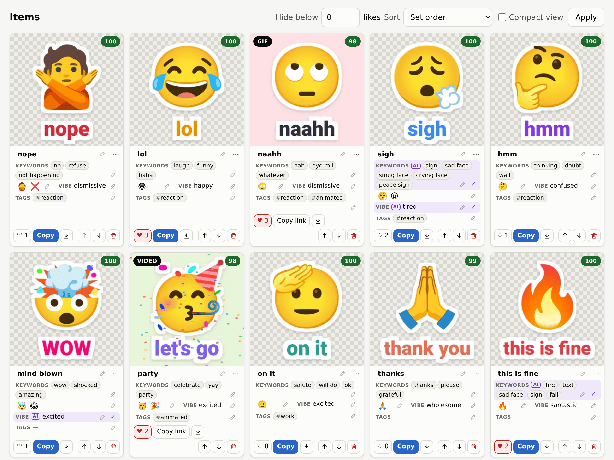
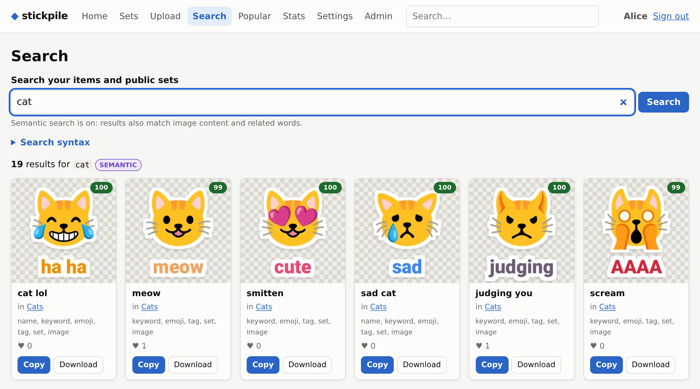
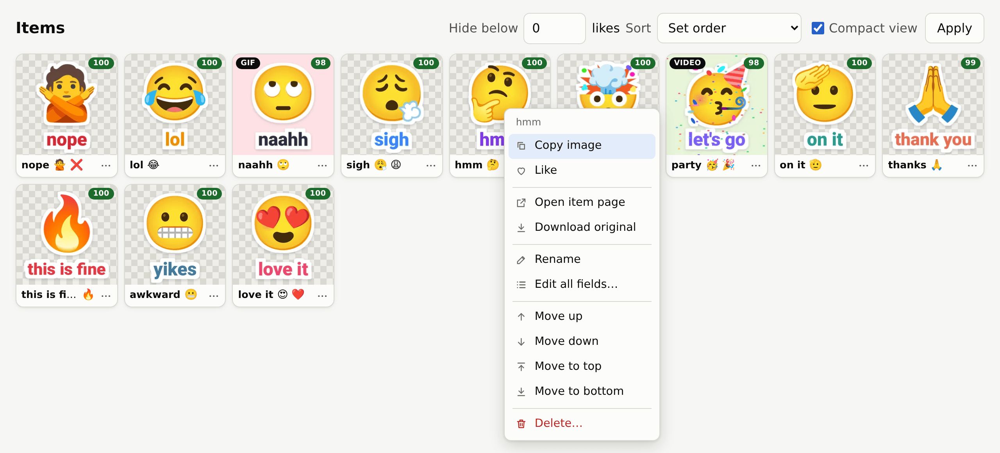
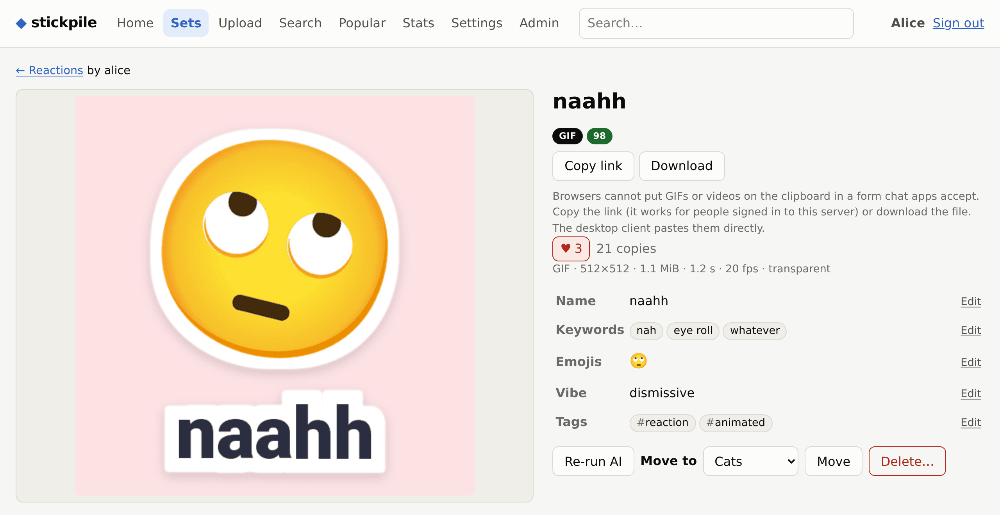
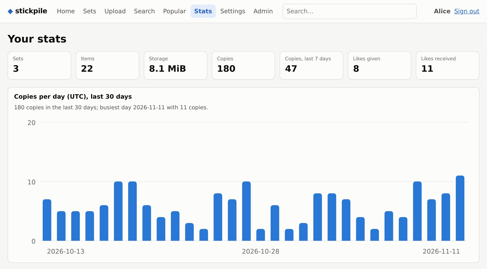

# stickpile

[](https://github.com/Dolfost/stickpile/actions/workflows/ci.yml)
[](LICENSE)

A self-hosted, platform-independent sticker and meme library. Keep your
stickers, GIFs and short videos on your own server, find one from any device
in a keystroke, and paste it into whatever chat app you are using: Telegram,
Discord, Signal, WhatsApp, Slack or a browser chat.

<picture>
  <source media="(prefers-color-scheme: dark)" srcset="docs/screenshots/set-editor-dark.png">
  
</picture>

- **Sets** like Telegram sticker packs (`private`, `unlisted` or `public`),
  stored as plain directories with a `set.toml` for import and export, or
  bound to a git repository that the server re-pulls.
- **Search as you type** with a keyboard-first syntax: `cat e:😂 vibe:tired
  q>70 type:gif`. Typos and stretched words (`naahh`) are forgiven, and an
  optional CLIP model matches what is *in* the picture, in English or 50+
  languages.
- **The right file for the target app.** Each item gets renditions on upload:
  PNG, a 512 px WebP Telegram sticker, a WebM video sticker, a GIF that fits
  Discord's limit, and an MP4. The desktop client sees which app is focused
  and picks one.
- **Quality badge** (0–100), near-duplicate detection and "find a better
  version" of the same meme.
- **Telegram import/export**: pull an existing pack into a set, or publish a
  set as a pack.
- **Collaboration**: add contributors to a pack and choose what each may do,
  or propose stickers and changes to someone else's pack; both sides follow
  the requests on a Collaboration tab ([docs](docs/collaboration.md)).
- **English and Ukrainian**: each user picks a language in the web UI's
  settings or in the desktop popup, and the choice follows them from one to
  the other ([docs](docs/languages.md)).
- **Multi-user**, with Tailscale login without passwords, local accounts with
  TOTP, revocable API tokens, an admin panel and an audit log.

Licence: [AGPL-3.0-or-later](LICENSE). The web UI's emoji data
(`crates/stickpile-server/assets/emoji.json`) is derived from Unicode emoji
and CLDR files, © Unicode, Inc., under the [Unicode License
v3](https://www.unicode.org/license.txt); see
[docs/web.md](docs/web.md#static-assets).

## Components

| | |
|---|---|
| `stickpile-server` | REST API (OpenAPI at `/api/v1/openapi.json`) and web UI |
| `stickpile` | command-line client |
| `stickpile-desktop` | Linux quick-search popup (GTK4/libadwaita), resident, bound to a global shortcut |
| `Stickpile.app` | the same popup for macOS, a menu bar app with its own shortcut ([docs/macos.md](docs/macos.md)) |

Android and a stickpile panel for Unexpected Keyboard come after v1 (see
[docs/plan.md](docs/plan.md)).

## Run the server

**NixOS** (full example in [docs/deployment.md](docs/deployment.md#nixos)):

```nix
{
  inputs.stickpile.url = "github:Dolfost/stickpile/stable"; # the latest release
  # ...
  imports = [ inputs.stickpile.nixosModules.default ];
  services.stickpile = {
    enable = true;
    settings = {
      server.public_url = "https://stickpile.example.ts.net";
      trusted_proxy.socket = "/run/stickpile/tailscale.sock";
      auth.tailscale_admins = [ "you@github" ];
    };
  };
}
```

```sh
sudo tailscale serve --bg --https=443 unix:/run/stickpile/tailscale.sock
```

**Podman** (rootless quadlet): copy `deploy/quadlet/stickpile.container` to
`~/.config/containers/systemd/`, set `STICKPILE_DIR` in a drop-in, and put
`config.toml` there. Step by step in
[docs/deployment.md](docs/deployment.md#podman-quadlet-rootless).

**Try it locally** from the checkout: `scripts/run-local.sh up` starts the
server (<http://localhost:8080>) and the desktop popup as systemd user
units ([details](docs/deployment.md#from-the-checkout-trying-it-locally)).

**From source:**

```sh
nix build .#stickpile-server
./result/bin/stickpile-server --config config.toml   # see crates/stickpile-server/config.example.toml
./result/bin/stickpile-server --config config.toml create-user alice --admin --password-file pw.txt
```

Every server option is documented in
[docs/configuration.md](docs/configuration.md). Secrets are always given as
file paths.

## Use it

**Web UI**: open the server URL. Upload, drop or paste files (rename,
crop, rotate and flip images before they are sent) or import a whole set
directory, edit keywords and emojis inline, confirm or override AI
suggestions, copy stills to the clipboard, and see popular items and your
stats. See [docs/web.md](docs/web.md).

<table>
  <tr>
    <td width="50%" valign="top">
      <a href="docs/screenshots/search-light.png">
        <picture>
          <source media="(prefers-color-scheme: dark)" srcset="docs/screenshots/search-dark.png">
          
        </picture>
      </a>
      <br><sub>Search: words, emojis, filters and what is in the picture</sub>
    </td>
    <td width="50%" valign="top">
      <a href="docs/screenshots/compact-menu-light.png">
        <picture>
          <source media="(prefers-color-scheme: dark)" srcset="docs/screenshots/compact-menu-dark.png">
          
        </picture>
      </a>
      <br><sub>Compact view and the right-click menu</sub>
    </td>
  </tr>
  <tr>
    <td width="50%" valign="top">
      <a href="docs/screenshots/item-light.png">
        <picture>
          <source media="(prefers-color-scheme: dark)" srcset="docs/screenshots/item-dark.png">
          
        </picture>
      </a>
      <br><sub>An item with its details and inline editing</sub>
    </td>
    <td width="50%" valign="top">
      <a href="docs/screenshots/stats-light.png">
        <picture>
          <source media="(prefers-color-scheme: dark)" srcset="docs/screenshots/stats-dark.png">
          
        </picture>
      </a>
      <br><sub>Your stats: copies per day over 30 days</sub>
    </td>
  </tr>
</table>

**CLI** ([docs/cli.md](docs/cli.md)):

```sh
stickpile login                         # passwordless on the tailnet, else username/password (+TOTP)
stickpile import ~/stickers/my-cats     # a directory with set.toml + 001-*.png ...
stickpile search cat type:gif           # your sets + public sets
stickpile copy naahh --target discord   # best match onto the clipboard
stickpile export my-cats ./my-cats      # write the set back out
stickpile gitpack add https://github.com/someone/their-pack
stickpile telegram import SomePackName
```

**Desktop** ([docs/desktop.md](docs/desktop.md)): start `stickpile-desktop
--hidden` with your session (the home-manager module does this), bind
`stickpile-desktop` to a key, then press it in any chat app, type, and press
Enter. Shift+Enter flips "send as sticker" for one copy, which puts the
512 px WebP on the clipboard for a real Telegram sticker. Ctrl+T switches
the target app.

```
# ~/.config/hypr/hyprland.conf
bind = SUPER, semicolon, exec, stickpile-desktop
```

```lua
-- ~/.config/hypr/hyprland.lua (Lua config, Hyprland 0.55+)
hl.bind('SUPER + semicolon', hl.dsp.exec_cmd('stickpile-desktop'))
```

The client config (`~/.config/stickpile/config.toml`, or
`programs.stickpile.settings` in home-manager) controls the server URL, cache
size, focus rules and which clipboard formats each app gets.

**macOS** ([docs/macos.md](docs/macos.md)): install the menu bar app with
Homebrew, set the server on its Settings tab and press Option+Space in a chat
app. Cmd stands in for Ctrl.

```
brew tap dolfost/stickpile https://github.com/Dolfost/stickpile
brew install --cask stickpile
```

## Search syntax

| | |
|---|---|
| `cat sigh` | words: name, keywords, emojis, vibe, tags, set name, image content |
| `e:😂` | has this emoji |
| `set:cats` | in a set (slug or name) |
| `vibe:tired` `tag:reaction` | exact vibe / tag |
| `type:gif` `type:video` `type:still` | media type or format |
| `q>70` `likes>=3` `copies>10` | quality, likes, copies |
| `by:alice` `is:mine` `is:liked` `is:public` | owner and state |
| `-tag:nsfw` `-word` | exclude |
| `sort:likes` `sort:recent` `sort:quality` | order |

More in [docs/search.md](docs/search.md).

## Set directory format

```
my-cats/
  set.toml
  001-cat.png
  002-naahh.gif
  003-sigh.mp4
```

```toml
version = 3
name = "My cats"
visibility = "unlisted"
aspect_ratio = "1:1"
recommended_px = 512

[items."002-naahh.gif"]
keywords = ["nah", "refuse"]
keywords_source = "ai"   # until you edit or confirm it
emojis = ["🙅"]
```

Full reference in [docs/set-format.md](docs/set-format.md). Git packs are
covered in [docs/git-packs.md](docs/git-packs.md).

## Status

v1 covers the server, web UI, CLI and the Linux desktop client. Pasting
into chat apps cannot be tested automatically. The per-app clipboard
behaviour therefore still has to be confirmed by hand with the matrix in
[docs/clipboard.md](docs/clipboard.md). Until then the clients use
provisional defaults that you can change in `config.toml` without
rebuilding.

## Development

```sh
nix develop                 # toolchain, GTK, ffmpeg, onnxruntime, sccache
cargo test --workspace
nix flake check             # packages, tests, clippy, fmt, module checks, NixOS VM test
```

See [CONTRIBUTING.md](CONTRIBUTING.md) before opening a pull request, and
[SECURITY.md](SECURITY.md) for reporting vulnerabilities.

More documentation is in [docs/](docs/): [architecture and plan](docs/plan.md),
[API](docs/api.md), [security](docs/security.md), [media
pipeline](docs/media.md), [quality score](docs/quality.md), [AI](docs/ai.md),
[Telegram](docs/telegram.md), [Nix](docs/nix.md) and [backup](docs/backup.md).
